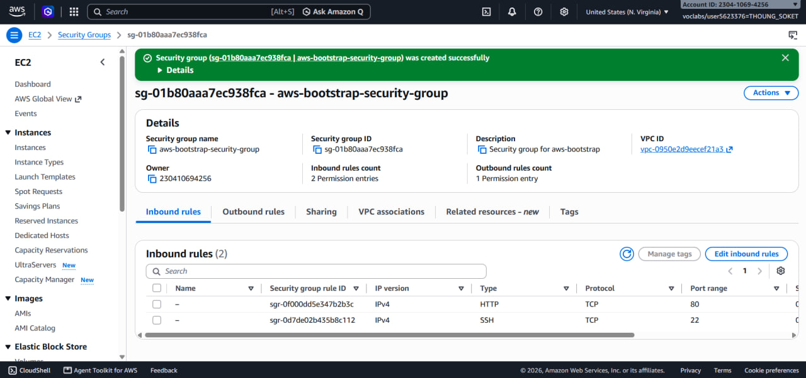
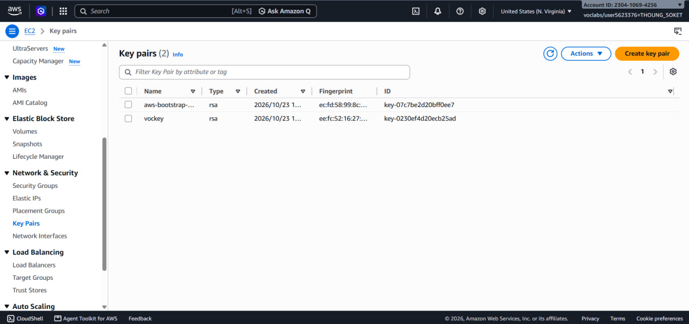
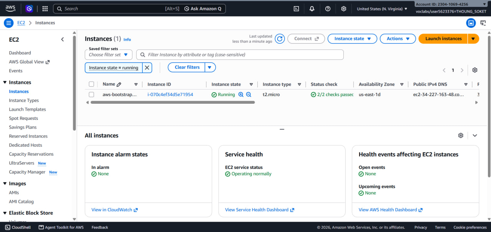
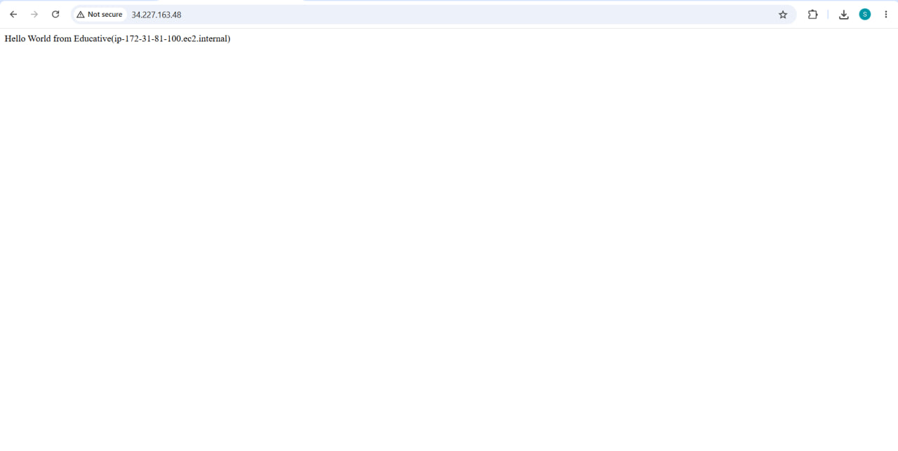
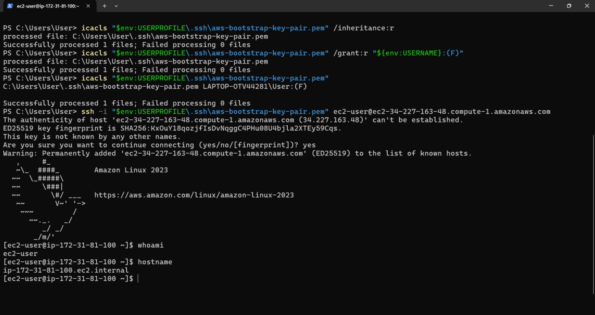
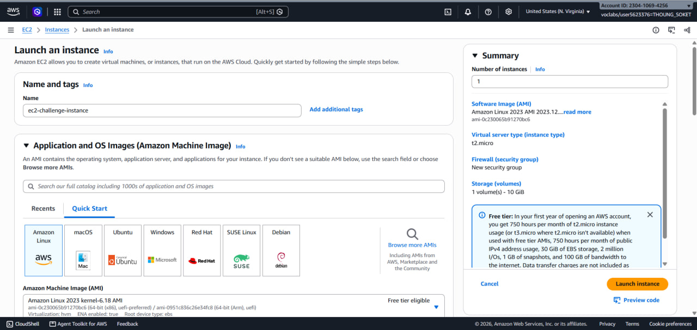
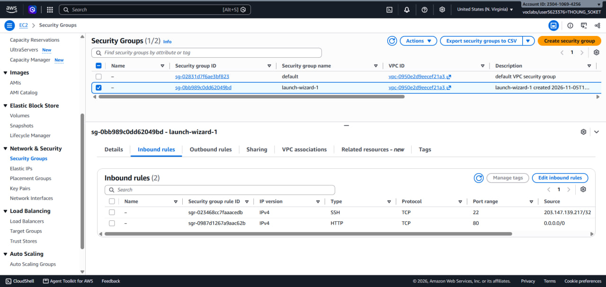
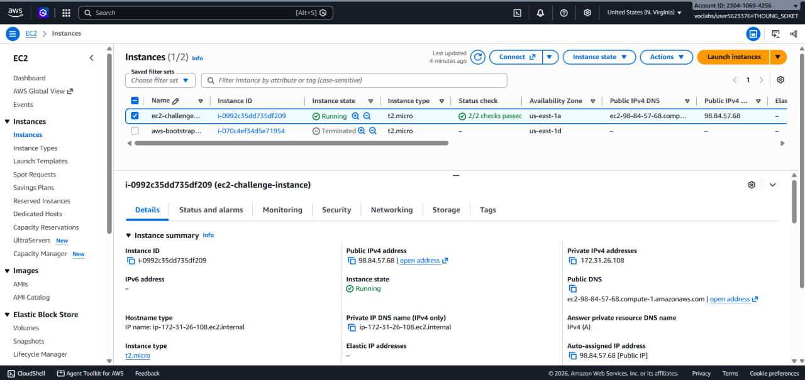
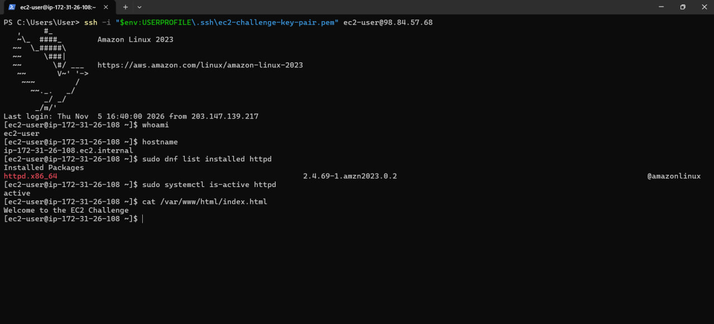
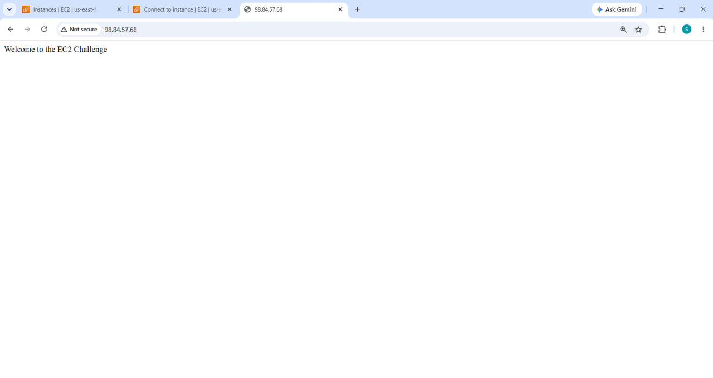

# Cloud Lab 1 Submission — Amazon EC2

**Student name:** THOUNG SOKET  
**Student ID:** e20220586  
**Learner Lab user name:** voclabs/user5623376=THOUNG_SOKET  
**Date completed:** 06/11/2026

---

## Part 1.1 — An Amazon EC2 Walkthrough

### Security group

I created a security group named `aws-bootstrap-security-group`.

I configured two inbound rules:

- SSH (Port 22) for remote access.
- HTTP (Port 80) for accessing the website.



### Key pair

I created an RSA key pair named `aws-bootstrap-key-pair` and downloaded the private key as a `.pem` file.

I used this key to connect to my EC2 instance.



### Instance details

I launched an EC2 instance with these settings:

- Instance name: `aws-bootstrap-instance`
- Operating system: Amazon Linux 2023
- Instance type: `t2.micro`
- Storage: 8 GiB
- Security group: `aws-bootstrap-security-group`
- Key pair: `aws-bootstrap-key-pair`

I used a user data script to install and start the Apache web server automatically.



### Browser test

I opened the public IP address of my instance in a browser using HTTP.

The web page displayed:

`Hello World from Educative(ip-172-31-81-100.ec2.internal)`

This confirmed that the Apache web server was working.



### SSH connection

I connected using my own SSH client through Windows PowerShell, not EC2 Instance Connect.

I used the private key `aws-bootstrap-key-pair.pem` to connect to my instance.

After connecting, I ran:

```bash
whoami
hostname
```

The results were:

```text
ec2-user
ip-172-31-81-100.ec2.internal
```

This confirmed that I successfully connected to my Linux server.



---

## Part 1.2 — EC2 Web Solution (Challenge)

### Launch configuration

I launched a new EC2 instance for the challenge with the following settings:

- Instance name: `ec2-challenge-instance`
- Operating system: Amazon Linux 2023
- Instance type: `t2.micro`
- Storage: 10 GiB (gp3)
- Key pair: `ec2-challenge-key-pair`
- Public IP: Enabled
- Region: `us-east-1`

I used the EC2 launch settings to configure the instance based on the teacher's requirements.



### Security group

I created a new security group named `launch-wizard-1`.

I configured two inbound rules:

- SSH (Port 22): Allowed access from My IP.
- HTTP (Port 80): Allowed access from anywhere (`0.0.0.0/0`).

The SSH rule allowed me to connect to the Linux instance, while the HTTP rule allowed users to access the web page.



### Running instance

I successfully launched the EC2 challenge instance.

Instance details:

- Instance name: `ec2-challenge-instance`
- Instance ID: `i-0992c35dd735df209`
- Instance type: `t2.micro`
- Public IPv4: `98.84.57.68`
- Status: Running
- Status checks: 2/2 passed

This confirmed that the instance was running correctly.



### Commands on the instance

First, I connected to the EC2 instance using Windows PowerShell and my private SSH key.

```powershell
ssh -i "$env:USERPROFILE\.ssh\ec2-challenge-key-pair.pem" ec2-user@98.84.57.68
```

After connecting, I checked the username and hostname:

```bash
whoami
hostname
```

Then I installed Apache:

```bash
sudo dnf install -y httpd
```

I started Apache and enabled it to start automatically after reboot:

```bash
sudo systemctl enable --now httpd
```

Next, I created an `index.html` file with the required message:

```bash
echo "Welcome to the EC2 Challenge" | sudo tee /var/www/html/index.html
```

I checked the file content:

```bash
cat /var/www/html/index.html
```

The output was:

```text
Welcome to the EC2 Challenge
```

I also checked that Apache was installed and running:

```bash
sudo dnf list installed httpd
sudo systemctl is-active httpd
```

The Apache service returned:

```text
active
```

This confirmed that Apache was installed, running, and the web page file was created successfully.



### Browser test

I opened the public IP address in Google Chrome:

`http://98.84.57.68`

The browser displayed:

`Welcome to the EC2 Challenge`

This confirmed that my EC2 web server was working and accessible through HTTP.



---

## Questions

### 1. Your security group has an SSH rule and an HTTP rule. What does each one let you do? What would stop working if you deleted the HTTP rule?

The SSH rule (Port 22) allows me to connect remotely to the EC2 instance.

The HTTP rule (Port 80) allows users to open the website in a browser.

If I delete the HTTP rule, users cannot access the website through HTTP from the internet. However, SSH can still work if Port 22 is allowed.

### 2. In Part 1.1 you never logged in to install the web server. What installed it, and when did it run?

The user data script installed the Apache web server automatically.

The script ran during the first launch of the EC2 instance. It installed Apache, started the service, and created the web page.

### 3. Why does the web page open with `http://` but not with `https://`?

The web server was configured to use HTTP on Port 80.

HTTPS uses Port 443 and requires TLS configuration and a certificate. I did not configure HTTPS in this lab.

### 4. Part 1.2 asked for a 10 GiB root volume. Where in the launch settings did you set it, and how can you check the size on the running instance?

I set the root volume size to **10 GiB** in the **Configure storage** section when launching my EC2 instance.

I selected the `gp3` storage type.

I could check the storage size in the EC2 instance's **Storage** tab in AWS Console.

I could also check it in the Linux terminal using:

```bash
lsblk
```

This command displays the storage devices and their sizes.

---

## Problems and How I Solved Them

In Part 1.1, I needed to configure the permissions of my private SSH key on Windows.

I moved the `.pem` file to the `.ssh` folder and used PowerShell commands to remove inherited permissions and grant access to my Windows user.

After that, I successfully connected to the EC2 instance using SSH.

In Part 1.2, I first tried to connect through EC2 Instance Connect in the browser, but the SSH connection failed.

I solved this problem by using Windows PowerShell and the downloaded private key.

After configuring the key permissions, I successfully connected to the EC2 instance and installed Apache.

---

## AI Note

I used ChatGPT to help me understand the SSH commands, configure the private key permissions, and troubleshoot the EC2 connection.

One suggestion was to use Windows PowerShell when EC2 Instance Connect failed.

I checked this suggestion by connecting to my EC2 instance with SSH, running `whoami` and `hostname`, and confirming that the connection worked.

---

## Clean Up

- [x] **Part 1.1:** EC2 instance terminated, key pair deleted, and security group deleted.
- [x] **Part 1.2:** EC2 instance termination initiated, key pair deleted, and security group deleted.

I cleaned up the AWS resources after completing the lab to avoid leaving unnecessary resources running.

---

## Conclusion

In this lab, I learned how to create an Amazon EC2 instance, configure security groups, generate SSH key pairs, and connect to a Linux server.

I also learned how to install Apache, create a simple web page, and test it using a public IP address.

Finally, I practiced deleting AWS resources after completing the lab.
