# Cloud Lab 2 Submission — Load Balancer and Auto Scaling

- **Student name:** THOUNG SOKET
- **Student ID:** e20220586
- **Learner Lab user name:** voclabs/user5623376 (THOUNG_SOKET)
- **Date completed:** November 27, 2026

---

## Security groups

I created two security groups: one for HTTP access to the load balancer and one for HTTP and SSH access to the EC2 instances.

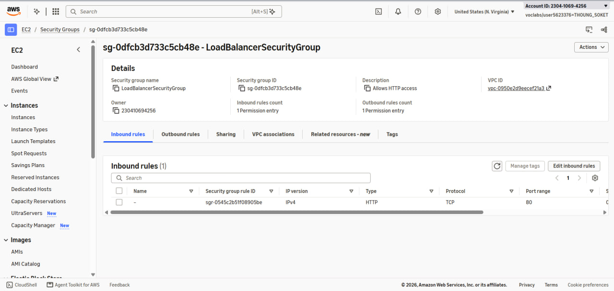

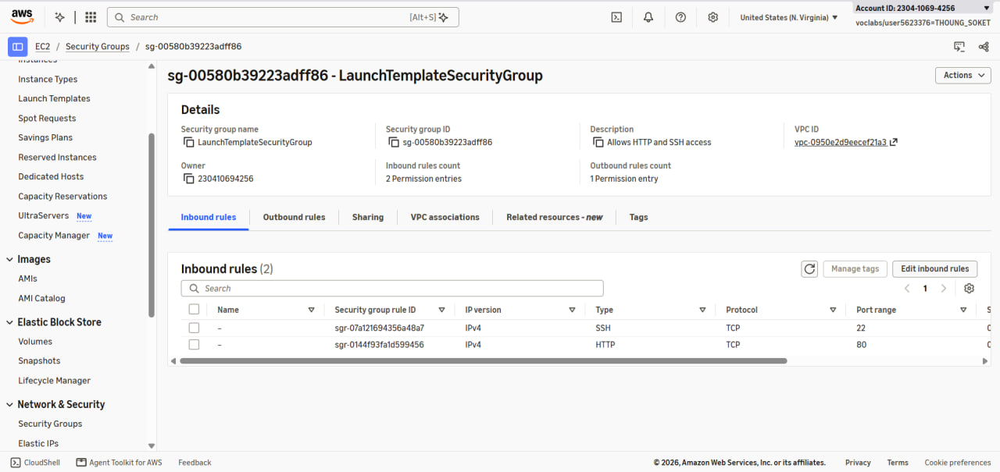

## Target group

I created `LoadBalancerTargetGroup` on HTTP port 80. The health check uses `/` to test if a web server responds.

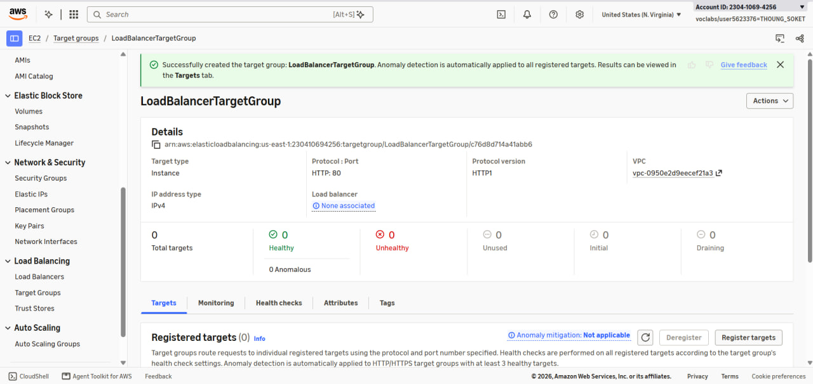

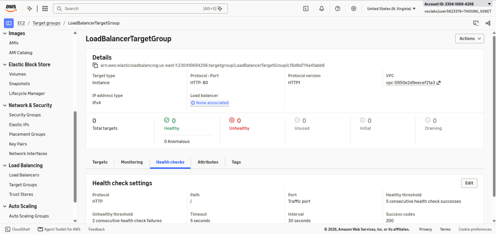

## Application Load Balancer

I created `MyLoadBalancer` to forward HTTP requests to healthy instances in the target group.

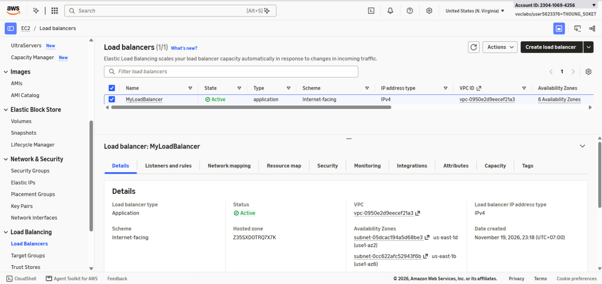

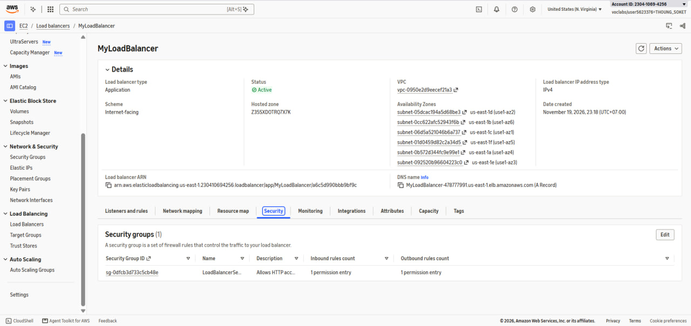

## Launch template

I used Amazon Linux 2023, `t2.micro`, and a user data script to install Apache and show a simple web page. The template helps Auto Scaling create instances with the same settings.

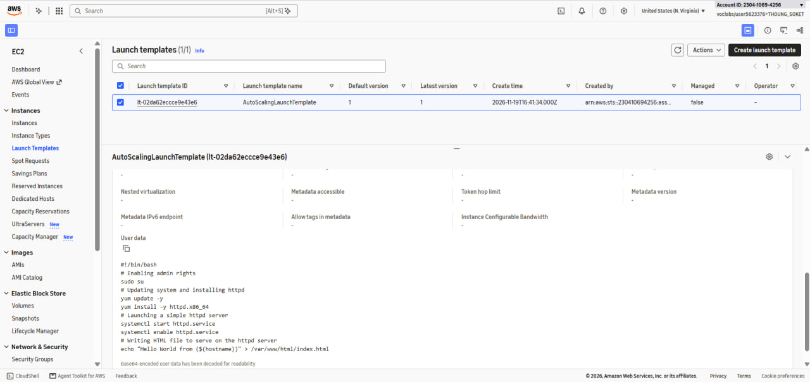

## Auto Scaling group

I created `MyAutoScalingGroup` with **desired 2, minimum 2, maximum 3** and enabled load balancer health checks so unhealthy instances can be replaced.

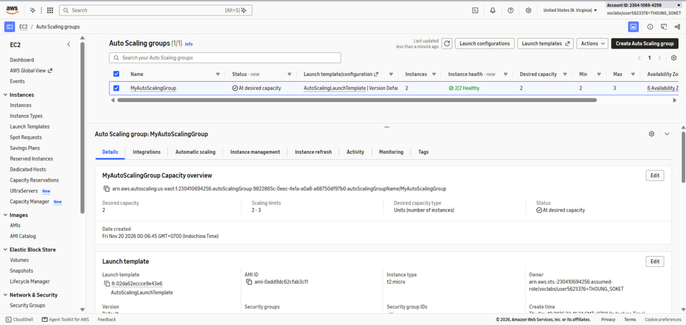

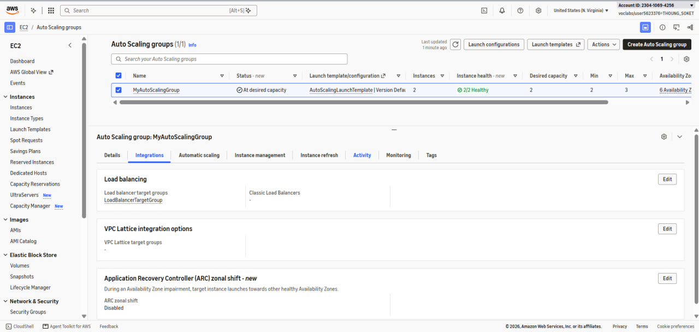

## Load balancing test

I opened the load balancer's DNS address and refreshed it. The different host names show that requests reached different EC2 instances.

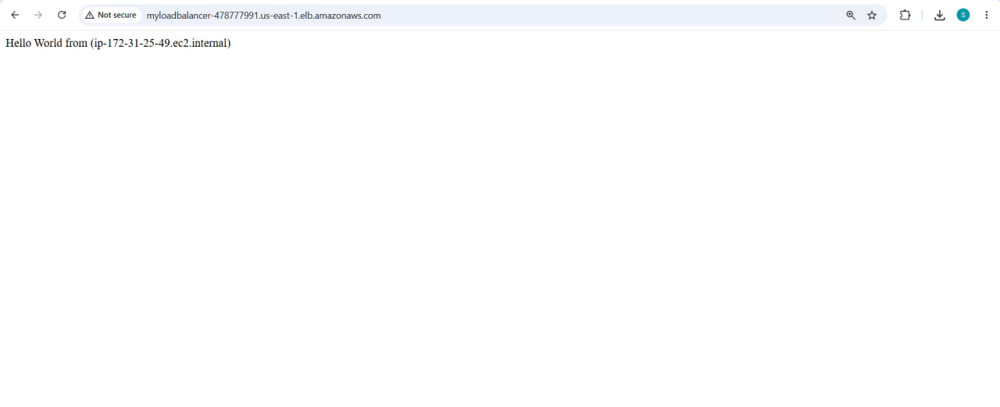

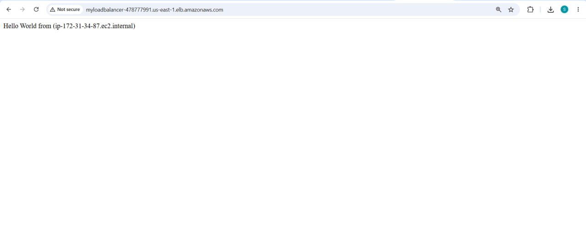

## Simulated application failure

I stopped Apache on one instance using `sudo systemctl stop httpd.service`. The target went into **Draining**, and Auto Scaling replaced it. The group returned to **2 Healthy** targets.

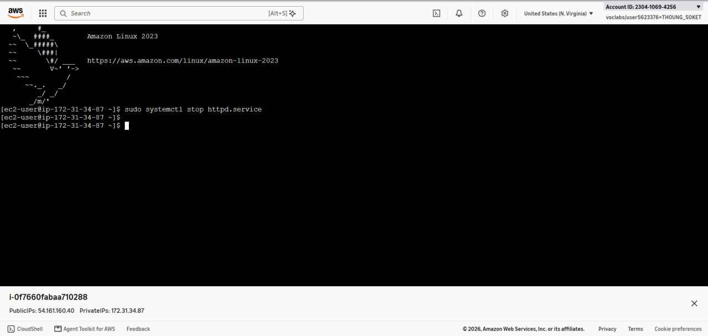

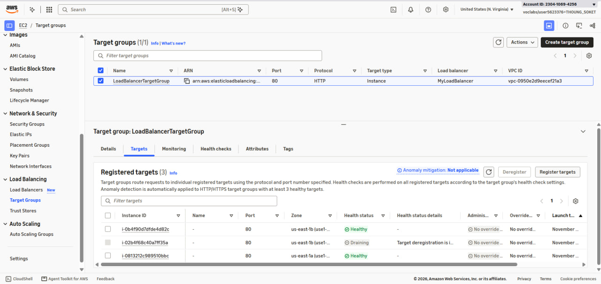

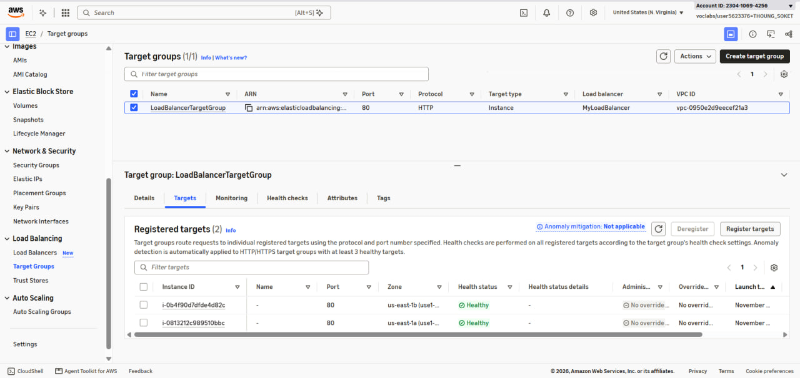

**About how many minutes passed?** I did not record the exact time.

---

## Questions

**1. Why did the host name change?**  
The load balancer sent requests to different healthy instances.

**2. Why was the target unhealthy while EC2 was running?**  
The HTTP health check expected a response from Apache on port 80. After Apache stopped, it could not respond.

**3. Who replaced the instance?**  
The **Auto Scaling group** replaced it. The **target group** checked its health, and the **load balancer** sent traffic to healthy targets.

**4. How many instances run normally, and when could there be 3?**  
Normally **2**. There could be **3** during scaling or while replacing an instance.

**5. How can HTTP access be limited to the load balancer?**  
Change the EC2 security group's HTTP port 80 source from `0.0.0.0/0` to `LoadBalancerSecurityGroup`.

## Problems and how I solved them (optional)

The failed target changed to **Draining** before I captured **Unhealthy**. I used the Draining screenshot, as allowed by the instructions.

## AI note (optional)

AI suggested checking the target group's health status. I verified the results in the AWS console.

## Clean up

- [x] `MyAutoScalingGroup` deleted and its instances terminated.
- [x] `AutoScalingLaunchTemplate` deleted.
- [x] `MyLoadBalancer` and `LoadBalancerTargetGroup` deleted.
- [x] Both security groups deleted.

