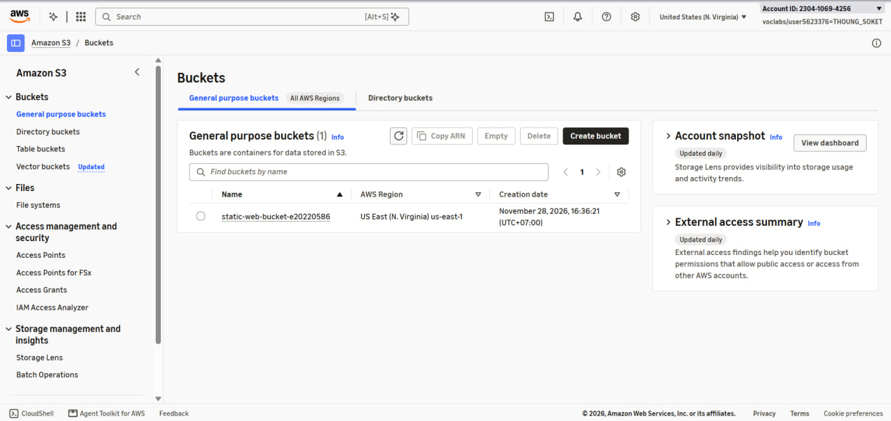
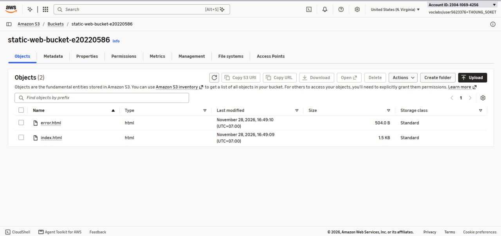
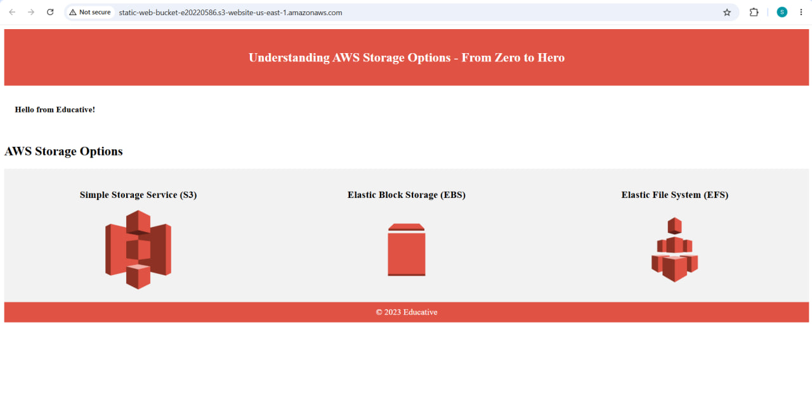
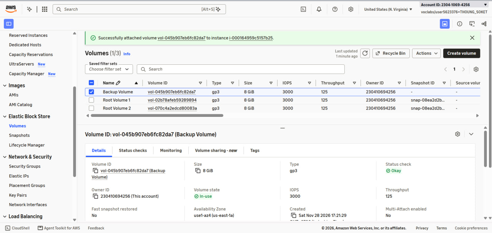
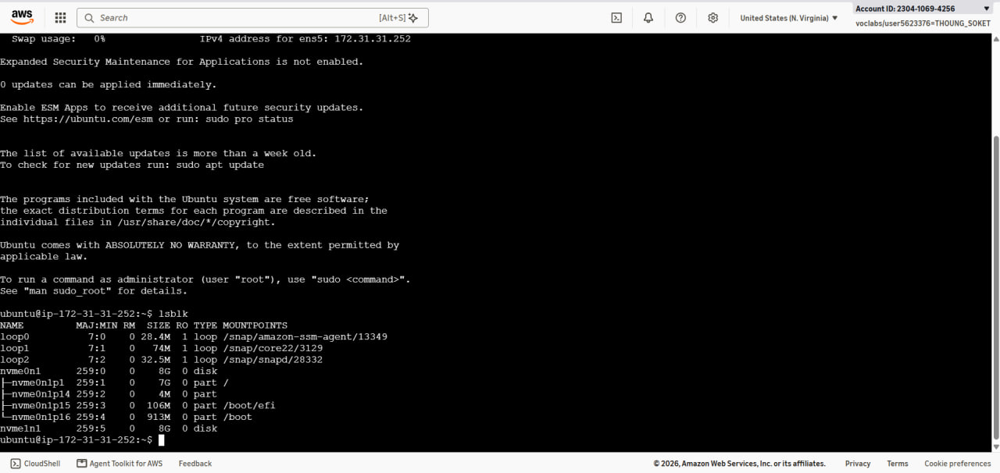
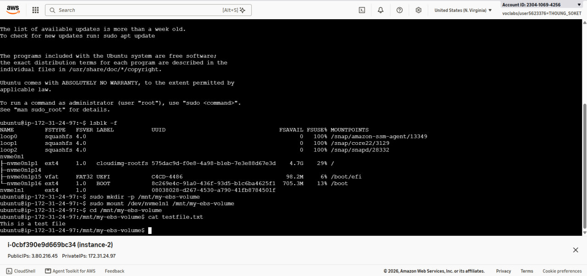
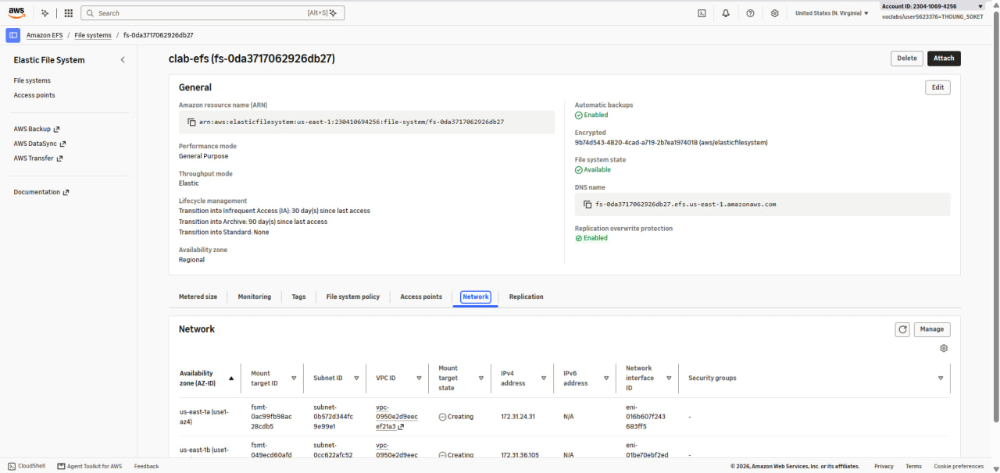
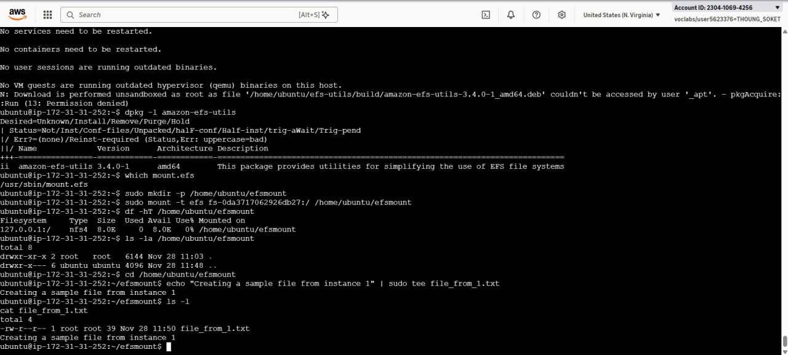
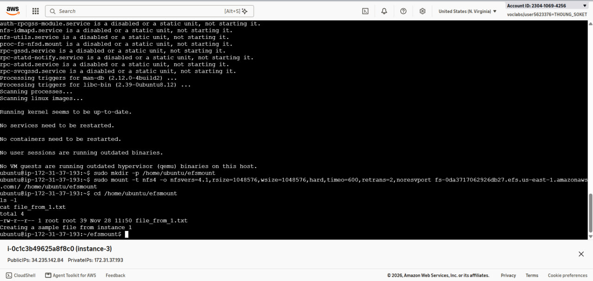

# Cloud Lab 3 Submission — AWS Storage Options

- **Student name:** THOUNG SOKET
- **Student ID:** e20220586
- **Learner Lab user name:** voclabs/user5623376=THOUNG_SOKET
- **Date completed:** 28 November 2026
- **AWS Region:** us-east-1 (N. Virginia)

---

## Part 2.1 — Amazon S3

### Bucket list

I created an S3 bucket named `static-web-bucket-e20220586` in `us-east-1`. S3 stores data as objects inside buckets.

### Uploaded files

I uploaded `index.html` and `error.html` to the bucket. The first file is for the website home page, and the second file is for errors.

### Static website

I enabled static website hosting and added a bucket policy to allow visitors to read the website files. After that, the website opened correctly in my browser.

---

## Part 2.2 — Amazon EBS

### Volumes page

I created an 8 GiB gp3 EBS volume named `Backup Volume` in `us-east-1a` and attached it to `instance-1`.

### Attached volume (`lsblk`)

I used `lsblk` to check the attached disk. On my Ubuntu EC2 instance, the extra EBS volume appeared as `/dev/nvme1n1`. I formatted it using ext4 and mounted it at `/mnt/my-ebs-volume`.

**Device name:** `/dev/nvme1n1`

### File read on instance-2

I created `testfile.txt` on the EBS volume with the text `This is a test file`. Then I unmounted and detached the volume from `instance-1`, attached it to `instance-2`, and mounted it again without formatting. I could read the same file on `instance-2`. This showed that the data stayed on the EBS volume.

---

## Part 2.3 — Amazon EFS

### File system and mount targets

I created an EFS file system named `clab-efs` with two mount targets, one in `us-east-1a` and one in `us-east-1b`. Both mount targets used the `efs-sg` security group to allow NFS traffic.

### File created on instance-1

I mounted EFS on `instance-1` at `/home/ubuntu/efsmount` and created `file_from_1.txt`. The file contained `Creating a sample file from instance 1`.

### File listed on instance-3

I mounted the same EFS file system on `instance-3`. I used `ls` and `cat file_from_1.txt` to check the file. It showed the same text, so I confirmed that both EC2 instances could share the EFS storage.

---

## Questions

**1. After you turned on static website hosting, the endpoint first answered 403 Forbidden. Why, and what changed after you added the bucket policy?**

The website returned 403 Forbidden because public visitors did not have permission to read the objects. Enabling website hosting alone did not give public access. After I added a bucket policy allowing `s3:GetObject`, visitors could read the website files.

**2. `testfile.txt` was still there after you moved Backup Volume to `instance-2`. What would have happened to a file saved on `instance-1`'s root volume after terminating `instance-1`?**

The root volume was configured to be deleted when the EC2 instance was terminated. A file saved only on that root volume would be lost. The separate Backup Volume kept its data when it was detached and moved.

**3. Why did you run `mkfs` on `instance-1` but not on `instance-2`?**

I used `mkfs` on `instance-1` to create the ext4 file system on the new EBS volume. On `instance-2`, the volume already had a file system and data. Running `mkfs` again could erase the existing file.

**4. Why could `instance-1` and `instance-3` use the EFS file system at the same time, when an EBS volume had to be detached first? Why did they have to be in the subnets of the mount targets?**

EFS is a shared network file system, so different EC2 instances can mount and use it at the same time. In this lab, EBS was attached as a block disk to one instance, so I detached it before attaching it to another. The EFS mount targets gave the instances network access to the shared file system in their Availability Zones.

**5. For each need, choose S3, EBS or EFS and give one reason.**

- **(a) A website's images — S3:** It stores objects such as images and can serve them to a website.
- **(b) The disk of a database server — EBS:** It provides block storage that an EC2 database server can use as a disk.
- **(c) A folder shared by several web servers — EFS:** Multiple servers can use the same files at the same time.

## Problems and how I solved them (optional)

When I installed the Amazon EFS client on `instance-1`, the installation failed because the 8 GiB root disk was full. I checked disk usage using `df -h /` and found that the Rust and EFS build files used a lot of space. After the package had been built, I removed temporary build files and Rust installation files, cleared the APT cache, and reinstalled the EFS package. This freed enough space to finish the installation and mount EFS.

## AI note (optional)

An AI tool suggested checking disk space after the EFS installation failed. I verified the problem by running `df -h /`, which showed the root disk was full. After cleaning temporary build files, I ran it again and confirmed that free space increased.

## Clean up

- [x] Instances `instance-1`, `instance-2`, and `instance-3` terminated.
- [x] `clab-efs` and Backup Volume deleted.
- [x] Security groups `efs-sg` and `ec2instances-sg` deleted.
- [x] S3 bucket emptied and deleted.

